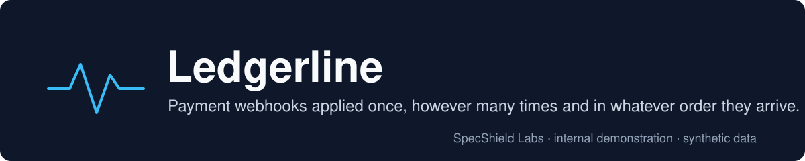
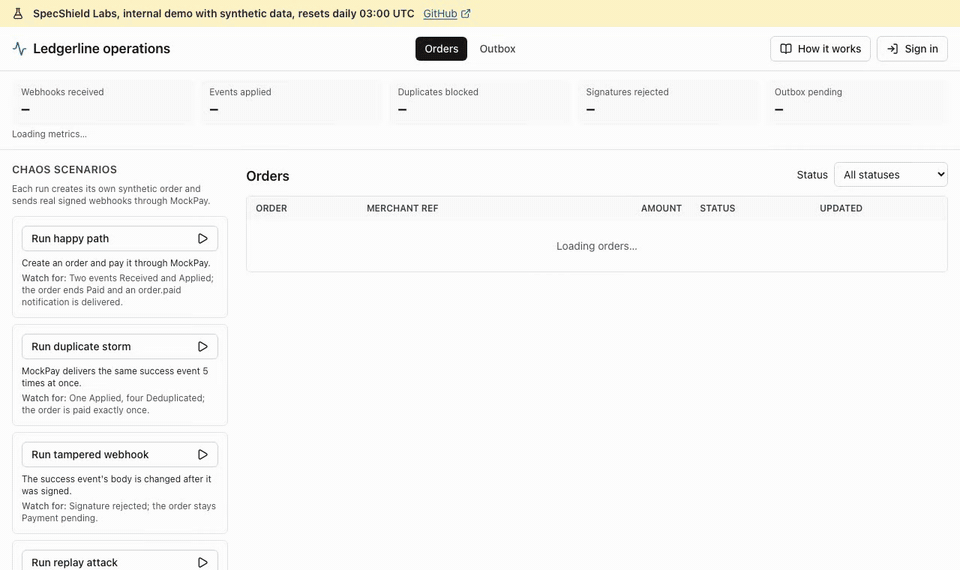
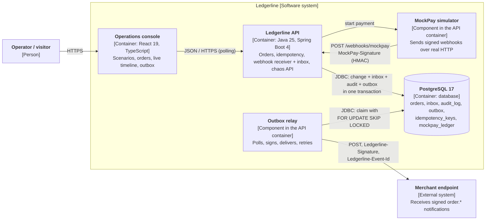
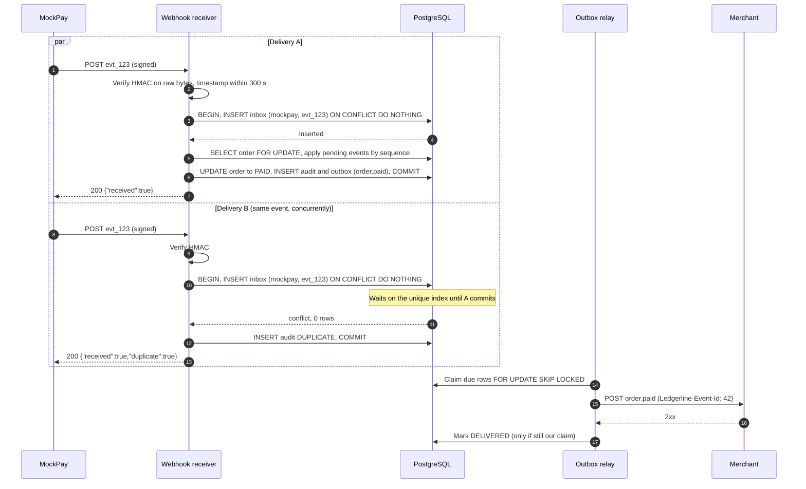

<p align="center">
  
</p>

<!-- Badges: live. Tests, coverage and mutation score are read from the evidence file CI publishes on every push to main. -->
[](https://github.com/specshield-io/ledgerline/actions/workflows/ci.yml)
[](https://specshield-io.github.io/ledgerline/evidence/latest.json)
[](https://specshield-io.github.io/ledgerline/reports/jacoco/)
[](https://specshield-io.github.io/ledgerline/reports/pit/)
[](https://github.com/specshield-io/ledgerline/actions/workflows/codeql.yml)
[](https://scorecard.dev/viewer/?uri=github.com/specshield-io/ledgerline)
[](LICENSE)

**Ledgerline shows, in running code and tests that prove it, how to process payment events so that a duplicated,
reordered or forged webhook can never corrupt an order and a committed change always reaches the merchant.**

> [!IMPORTANT]
> **Internal demonstration, synthetic data, not a production payment system.** Ledgerline is an engineering
> demonstration by SpecShield Labs. It is not PCI DSS scoped and must not process real payments or personal data.

<p align="center">
  
</p>

**Live demo:** not published yet · **2-minute video:** not published yet ·
**[Evidence page](https://specshield-io.github.io/ledgerline/)** (test counts, coverage, mutation score and reports
from the latest CI run on `main`)

The recording above is the real console against `docker compose up`, made with
[`ops-console/scripts/record-gif.mjs`](ops-console/scripts/record-gif.mjs) (17 s).

---

**Contents:** [1. The problem](#1-the-problem) · [2. What this demonstrates](#2-what-this-demonstrates) ·
[3. Architecture](#3-architecture) · [4. Quick start](#4-quick-start) ·
[5. Try the failure scenarios](#5-try-the-failure-scenarios) · [6. Test strategy](#6-test-strategy) ·
[7. Security notes and known limitations](#7-security-notes-and-known-limitations) ·
[8. At 10x scale we would…](#8-at-10x-scale-we-would) · [9. Code tour](#9-code-tour) ·
[10. About SpecShield Labs](#10-about-specshield-labs) · [Further reading](#further-reading)

## 1. The problem

Payment providers tell you what happened through webhooks, and webhooks are hostile input:

- **Duplicates.** Providers deliver at least once. A lost `200` means the same "payment succeeded" arrives again,
  sometimes five times in the same second. Applied twice, a refund is two refunds.
- **Out of order.** A retried "payment failed" can arrive after "payment succeeded". Applied in arrival order, a
  paid order goes back to failed.
- **Forgeries and replays.** The endpoint is public. Anyone can POST a "payment succeeded", or capture a genuine
  one and send it again next week.
- **Dual-write inconsistency.** "Update the order, then call the merchant" loses the notification when the process
  dies between the two; "call, then update" announces changes that then roll back. No transaction spans a
  database and an HTTP call.
- **Retries from your own clients.** A timeout on `POST /orders` leaves the client unsure whether to retry; without
  idempotency, retrying creates a second order.

## 2. What this demonstrates

Each guarantee is enforced by a named mechanism and proven by tests with catalogue IDs you can grep for
(`grep -rn "LL-I08" .`).

| Guarantee | Mechanism | Proven by |
|---|---|---|
| A forged, tampered or replayed webhook never changes an order | HMAC-SHA256 over the raw bytes and a signed timestamp, constant-time compare, 300 s window ([ADR 0002](docs/adr/0002-webhook-signature-and-inbox.md)) | LL-U08 to LL-U13, LL-I09, LL-I21, LL-E03 |
| A duplicate is applied once, even 50 concurrent copies | Inbox row with a unique key, in the same transaction as the change | LL-I07, LL-I08, LL-I21, LL-E02 |
| Events arriving in any order converge to the right state | Order row lock plus `OrderEventSequencer` applying events by sequence | LL-P01 (1000 generated histories), LL-U06, LL-E05 |
| A merchant notification exists if and only if the change committed | Transactional outbox written in the change's transaction ([ADR 0003](docs/adr/0003-transactional-outbox.md)) | LL-I13 |
| A merchant outage loses nothing; failures are visible and replayable | Retries with full-jitter backoff, timeouts, dead letters, admin replay, crash watchdog | LL-U14, LL-I15, LL-I16, LL-I18, LL-I20, LL-E04 |
| Several relays never deliver the same row concurrently | `FOR UPDATE SKIP LOCKED` claims and claim-conditional updates ([ADR 0004](docs/adr/0004-postgres-skip-locked-over-a-broker.md)) | LL-I17 |
| A client can retry any state-changing request safely | `Idempotency-Key` with a request fingerprint and byte-exact replay ([ADR 0005](docs/adr/0005-idempotency-key-design.md)) | LL-I01 to LL-I05 |
| Every error is machine-readable | RFC 9457 `application/problem+json` with stable type URNs | LL-C02 |
| Admin actions need a role; the public API is rate limited | HTTP Basic with BCrypt hashes, per-IP token buckets, trusted-proxy rule | LL-C03, LL-C04 |
| The domain stays free of framework code | ArchUnit layering rules | LL-A01, LL-A02 |
| The quick start works on a clean machine | CI job that clones, starts and exercises the stack | LL-N06 |

Prefixes: `U` unit, `P` property, `I` integration, `C` contract and cross-cutting, `E` end to end, `F` console,
`A` architecture, `N` non-functional.

## 3. Architecture

**Container view (C4 level 2).** Two containers at runtime: the Ledgerline application (API, outbox relay, MockPay
simulator and the console's static files, in one Spring Boot jar) and PostgreSQL. The relay and MockPay are drawn
separately because they matter here; MockPay runs in the same process but talks to the API only over real, signed
HTTP.



**A duplicate delivery.** MockPay sends the same `PAYMENT_SUCCEEDED` twice at the same moment. The unique inbox key
makes the second transaction wait for the first, then see the conflict.



The order changes once, the merchant hears about it once in the normal case, and the second delivery is still
recorded (a `DUPLICATE` audit row and the `ledgerline_webhook_duplicates_total` metric). Merchant delivery is
at-least-once, so merchants deduplicate by `Ledgerline-Event-Id`.

Package layout and rules: [AGENTS.md](AGENTS.md#2-layout). Every design decision: [ADRs](docs/adr/0001-record-architecture-decisions.md).

## 4. Quick start

**Prerequisites:** Docker with Compose v2 (Docker Desktop, or Colima on macOS). To run the tests you also need
JDK 25.

```bash
git clone https://github.com/specshield-io/ledgerline.git && cd ledgerline
docker compose up --build        # builds the image, starts PostgreSQL 17 and the app
```

Then open **<http://localhost:8080>**. The stack is ready when `curl localhost:8080/actuator/health` returns
`{"status":"UP"}`.

```bash
./mvnw verify                    # all JVM tests: unit, Testcontainers integration, coverage gate, SBOM
```

**How long it takes.** The CI job `fresh-clone` (LL-N06) runs `docker compose up -d` on a new GitHub-hosted runner
with empty caches, so the time includes building the image, and fails unless the app is healthy within 180 s. It
then runs one scenario with curl and tears down. Its log prints the measured time; run it yourself with
[`scripts/fresh-clone-check.sh`](scripts/fresh-clone-check.sh). Your first build downloads Maven and npm
dependencies, so it depends on your network.

<details>
<summary>Ports taken, or using Colima?</summary>

```bash
LEDGERLINE_HTTP_PORT=18080 LEDGERLINE_DB_PORT=15432 docker compose up --build
```

Testcontainers with [Colima](https://github.com/abiosoft/colima):

```bash
export DOCKER_HOST="unix://$HOME/.colima/default/docker.sock"
export TESTCONTAINERS_DOCKER_SOCKET_OVERRIDE=/var/run/docker.sock
```

</details>

## 5. Try the failure scenarios

**In the console:** open <http://localhost:8080>, click a scenario on the left, and watch its order's timeline fill
in: Received, Applied, Deduplicated, Stale (out of order), Signature rejected, Notification queued, Retry scheduled,
Outbox delivered.

**With curl:** each scenario creates its **own** synthetic order and drives it with real signed HTTP webhooks from
MockPay; it never touches existing orders.

```bash
B=http://localhost:8080
start() { curl -s -X POST "$B/api/v1/chaos/scenarios/$1" -H "Idempotency-Key: $(uuidgen)"; echo; }

start happy-path        # create + pay through MockPay                       -> PAID
start duplicate-storm   # the success event delivered 5 times at once        -> PAID, applied once, 4 DUPLICATE
start tampered-webhook  # body altered after signing                         -> 400, REJECTED, stays PAYMENT_PENDING
start replay-attack     # valid signature, timestamp 10 minutes old          -> 400, REJECTED, stays PAYMENT_PENDING
start out-of-order      # SUCCEEDED (seq 2), then a late FAILED (seq 1)      -> PAID, one STALE
start merchant-down     # demo merchant answers 500 for 2 min                -> order.paid retried, DELIVERED after
start merchant-slow     # demo merchant takes 10 s for 2 min                 -> deliveries time out at 3 s, retried
start refund-flow       # pay, refund 15.00, refund the remaining 34.99      -> REFUNDED
```

Each call answers `202 {"scenarioRunId": ..., "orderId": ...}`. Then:

```bash
curl -s "$B/api/v1/chaos/runs/<scenarioRunId>"          # steps, with the receiver's HTTP status for each
curl -s "$B/api/v1/orders/<orderId>/timeline"           # inbox, audit and outbox, merged
curl -s "$B/demo/merchant-sink"                          # what the demo merchant received
curl -s -u local-viewer:local-dev-only-viewer-password "$B/api/v1/admin/outbox?status=PENDING"
curl -s "$B/api/v1/stats"                                # received, applied, duplicates, rejections, outbox
```

Limits: 10 scenario starts per minute per client and 3 runs in progress at once across everyone (`429` with
`Retry-After`). `merchant-down` and `merchant-slow` switch the shared demo merchant for 2 minutes. The 25 demo
orders reset every night at 03:00 UTC. The local accounts above are synthetic and only exist in the `local` profile.

Want to drive the API by hand? The order, payment and idempotency endpoints are in the
[reference](docs/reference.md#api) and in [`docs/openapi.json`](docs/openapi.json) (Swagger UI at
<http://localhost:8080/swagger-ui.html>).

## 6. Test strategy

Integration tests run against real PostgreSQL 17 in Testcontainers, never H2, because the guarantees above are
PostgreSQL behaviour (unique indexes under concurrency, `FOR UPDATE`, `SKIP LOCKED`). Why, and what we traded:
[ADR 0006](docs/adr/0006-testing-strategy.md).

```
                 ▲   E2E (Playwright + axe)          LL-E01..E07   real stack in docker compose
                ▲▲▲  Integration (Testcontainers)    LL-I, LL-C    real PostgreSQL 17, real HTTP (WireMock)
            ▲▲▲▲▲▲▲  Unit + property + architecture  LL-U, LL-P, LL-A  JUnit 6, jqwik, ArchUnit; PIT-gated
  Console unit tests (Vitest, Testing Library, MSW) LL-F01..F05 · Non-functional: k6, ZAP, Trivy, CodeQL, LL-N06
```

**Counts**, from the [evidence file](https://specshield-io.github.io/ledgerline/evidence/latest.json) CI produced
for commit `131de0e` on 2026-11-24 (CI run
[45389638927](https://github.com/specshield-io/ledgerline/actions/runs/45389638927)). The badges at the top show the
latest run.

| Measure | Value | Source report |
|---|---|---|
| JVM unit tests (surefire) | 221 | `*Test` classes |
| Integration tests (failsafe) | 134 | `*IT` classes |
| End-to-end tests (Playwright) | 11 | `ops-console/e2e` |
| Total / failed | 366 / 0 | |
| Line coverage, overall / `domain` | 95.2 % / 99.5 % | JaCoCo (gate: 90 %) |
| Mutation score | 90.2 % | PIT on `domain`, `webhook`, `outbox`, `application` (gate: 70 %) |
| Load test (k6, 200 webhooks/s, 20 % duplicates) | not measured yet | LL-N01 runs on demand; the evidence shows `null` until it has run on `main` |

Console unit tests (Vitest) run in CI but are not yet counted in the evidence file.

**Run each layer:**

| Layer | Command |
|---|---|
| Unit, property, architecture, integration, coverage gate | `./mvnw verify` (backend only: `./mvnw verify -Dskip.frontend`) |
| Mutation testing (fails below 70 %) | `./mvnw -Pmutation -Dskip.frontend test-compile pitest:mutationCoverage` |
| Console unit tests | `cd ops-console && npm ci && npm test` |
| End to end | `docker compose up --build --wait`, then `ops-console/scripts/e2e-docker.sh` (pinned Playwright image, as CI) |
| Load test | `docker compose -f docker-compose.yml -f docker-compose.perf.yml up --build --wait && perf/run.sh` |
| Fresh clone (LL-N06) | `scripts/fresh-clone-check.sh` |
| Evidence assembler | `node --test evidence/assemble.test.mjs` |

All quality gates and when they run: [reference](docs/reference.md#evidence-and-quality-gates).

## 7. Security notes and known limitations

What is in place: signed webhooks in both directions with zero-downtime secret rotation; HTTP Basic admin roles
(`VIEWER` reads, `ADMIN` changes) against BCrypt hashes from configuration; deny-by-default access rules; per-IP rate
limits with a trusted-proxy rule for `X-Forwarded-For`; strict security headers and CSP; 64 KiB body limit;
problem+json errors that never leak stack traces; CodeQL, Trivy, OWASP ZAP, Dependabot and a CycloneDX SBOM per
release. Details: [reference, Security](docs/reference.md#security). Report vulnerabilities as described in
[SECURITY.md](SECURITY.md).

What it is **not**, honestly:

- **MockPay is not a real payment provider.** It is an in-process simulator that sends real signed HTTP webhooks.
  There is no card network, no real money and no PCI DSS scope. Integrating a real provider means its SDK, its
  signature scheme and its event model.
- **Rate limits are in memory, per instance.** With N instances the effective limit is N times higher, and limits
  reset on restart. A shared store (Redis) or the edge proxy would be needed for a real limit.
- **Single region, single database.** No replication, failover or backups are configured; the database is a single
  point of failure.
- **Admin authentication is HTTP Basic** against accounts in configuration. Fine for a demo console; a real
  operator console would use SSO (OIDC) with MFA and short-lived sessions.
- **The public API has no client authentication** (it is a public demo), so idempotency keys are global rather than
  per client.
- **Delivery to merchants is at-least-once and unordered**, by design ([ADR 0003](docs/adr/0003-transactional-outbox.md)).
- **An idempotency window remains:** if the process dies between the business commit and storing the response,
  the key answers `409` until it expires after 24 h ([ADR 0005](docs/adr/0005-idempotency-key-design.md)).
- **No retention jobs** for the inbox, audit log or outbox tables yet; the webhook endpoint is not rate limited
  (it is authenticated by signature), so rejected deliveries can grow the inbox.
- **Code-scanning notes are open.** CodeQL has no open alerts above `note` severity; the remaining notes (unused
  local variables and parameters, unchecked number parsing) are code-quality items not yet cleaned up.
- **Alert rules are not configured.** The metrics to alert on are listed in the [runbook](docs/runbook.md#what-to-alert-on).

## 8. At 10x scale we would…

The current design is the cheapest correct one for one service and demo volumes. We have not load-tested beyond
the k6 scenario (LL-N01), so this is a plan, not a measured result. In order of when each step pays off:

1. **Partition the outbox** by time (PostgreSQL declarative partitioning) so delivered rows are dropped by partition
   instead of deleted, and add retention for the inbox and audit log. The polling relay with `SKIP LOCKED` already
   scales out across instances without coordination.
2. **Put a broker behind the outbox** once there is a second consumer or polling shows up in database load: the
   relay publishes to Kafka (key = order id, for per-order ordering) or SQS FIFO, or Debezium reads the outbox from
   the WAL. The outbox stays, and the event id merchants deduplicate on does not change
   ([ADR 0004](docs/adr/0004-postgres-skip-locked-over-a-broker.md), [ADR 0003 §7](docs/adr/0003-transactional-outbox.md#7-moving-to-kafka-or-sqs-later)).
3. **Shared rate limiting and multiple instances** behind a load balancer: limits in Redis or at the edge, sessions
   unchanged (the API is stateless).
4. **Multi-region:** a managed PostgreSQL with a synchronous standby for failover, read replicas for the timeline and
   list endpoints, and webhook ingestion in each region writing to the primary. Active-active writes would need
   order-level ownership per region, which we would only take on with a concrete latency requirement.
5. **A secrets manager** (AWS Secrets Manager, GCP Secret Manager or Vault) for the webhook, merchant and database
   secrets, with the rotation in the [runbook](docs/runbook.md#rotate-a-webhook-secret-with-zero-downtime)
   automated, and per-merchant secrets and endpoints in a merchant table.
6. **SSO for operators** and an append-only audit store, plus SLOs and alerts on outbox age and webhook failures.

## 9. Code tour

Six files that carry the design, in reading order:

| File | Why read it |
|---|---|
| [`webhook/WebhookSignatureVerifier.java`](ledgerline-api/src/main/java/com/specshield/ledgerline/webhook/WebhookSignatureVerifier.java) | Raw-byte HMAC, bounded header parsing, constant-time compare, rotation: the front door. |
| [`application/PaymentEventService.java`](ledgerline-api/src/main/java/com/specshield/ledgerline/application/PaymentEventService.java) | One transaction: inbox insert, order lock, apply, audit and outbox. Where duplicates die. |
| [`domain/OrderEventSequencer.java`](ledgerline-api/src/main/java/com/specshield/ledgerline/domain/OrderEventSequencer.java) | Applies an order's events in sequence order whatever the arrival order; pure Java, property-tested. |
| [`persistence/JdbcOutboxStore.java`](ledgerline-api/src/main/java/com/specshield/ledgerline/persistence/JdbcOutboxStore.java) | The `SKIP LOCKED` claim and the claim-conditional updates that make concurrent relays safe. |
| [`application/IdempotencyService.java`](ledgerline-api/src/main/java/com/specshield/ledgerline/application/IdempotencyService.java) | Claim, fingerprint, replay, abandon: retry-safe POSTs in under 150 lines. |
| [`domain/EventReplayPropertyTest.java`](ledgerline-api/src/test/java/com/specshield/ledgerline/domain/EventReplayPropertyTest.java) | LL-P01: 1000 duplicated, shuffled histories must all converge to the canonical result. |

## 10. About SpecShield Labs

SpecShield Labs is a small engineering firm. Ledgerline is how we show our working: every guarantee above has a
mechanism, a test ID and a CI report behind it, and every number in this README comes from a run you can
reproduce.

**Contact:** open an [issue](https://github.com/specshield-io/ledgerline/issues) on this repository, or reach the maintainers through the
[specshield-io organisation on GitHub](https://github.com/specshield-io). Security reports: see
[SECURITY.md](SECURITY.md).

## Further reading

| Document | For |
|---|---|
| [docs/reference.md](docs/reference.md) | API, idempotency, webhooks, outbox, security, observability, domain model, schema |
| [docs/adr/](docs/adr/0001-record-architecture-decisions.md) | Architecture decisions 0001 to 0006 (MADR) |
| [docs/runbook.md](docs/runbook.md) | Deploy, reset, rotate secrets, read metrics, common incidents |
| [AGENTS.md](AGENTS.md) | Engineering rules and Definition of Done (for humans and AI agents) |
| [CONTRIBUTING.md](CONTRIBUTING.md) · [CHANGELOG.md](CHANGELOG.md) · [SECURITY.md](SECURITY.md) | Contributing, releases, vulnerability reports |
| [ops-console/README.md](ops-console/README.md) | The React operations console |

Licence: [Apache-2.0](LICENSE).
